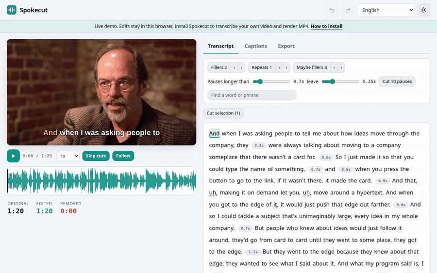

# Spokecut

Edite vídeos de gente falando editando a transcrição. Apague uma palavra e ela some do vídeo. Roda na sua própria máquina e é grátis.

[](https://github.com/Arthur031221/Spokecut/actions/workflows/ci.yml)
[](LICENSE)
[](docs/install.md)

[Demo ao vivo](https://arthur031221.github.io/Spokecut/) | [Instalação](docs/install.md) | [Uso](docs/usage.md) | [Configuração](docs/config.md) | [Arquitetura](docs/architecture.md) | [Benchmarks](docs/benchmarks.md)

[English](README.md) | [繁體中文](README.zh-TW.md) | [简体中文](README.zh-CN.md) | [日本語](README.ja.md) | [한국어](README.ko.md) | [Español](README.es.md) | [Français](README.fr.md) | [Deutsch](README.de.md) | Português (Brasil)



Um vídeo de 5 minutos de uma pessoa falando é transcrito, limpo e renderizado com legendas gravadas em 15,0 s numa RTX 5090, 20,0 vezes mais rápido que o tempo real. É o trabalho inteiro a partir de uma partida a frio (`python bench/bench.py pipeline talk.mp4`, média de 4 execuções, de 14,7 a 15,1 s, `large-v3-turbo` e NVENC). Num Ryzen 5 7500F com 3 threads, `small` e x264, o mesmo vídeo leva 61,1 s.

Seu vídeo nunca sai da sua máquina. Prefiro dizer que o Whisper esconde a maior parte dos seus "hum" e "é" a fingir que o botão de vícios de linguagem acha todos.

## Antes e depois

Os números vêm do clipe de demonstração de 80 segundos, o mesmo da demo ao vivo, a menos que a linha diga outra coisa.

| O que você quer | À mão num editor de linha do tempo | Spokecut |
| --- | --- | --- |
| Cortar 10 pausas maiores que 0,7 s | Achar cada uma de ouvido, dividir, apagar com ondulação, dez vezes | Um clique, ou `--pauses 0.7 --no-fillers --no-repeats --model large-v3`. 80,3 s viram 73,4 s |
| Tirar um "uh" e uma palavra repetida | Ficar arrastando até ouvir | Clique na palavra e aperte Delete, ou use os botões de vícios e repetições |
| Cortar uma frase inteira | Procurar o começo e o fim na forma de onda | Selecione as palavras e aperte Delete. Os cortes se ajustam ao ponto mais silencioso entre palavras |
| Evitar um estalo onde dois trechos se encontram | Colocar uma transição cruzada em cada corte | Toda emenda tem um fade de 15 ms. No clipe de 300 segundos, 3 de 37 emendas passaram de 10 vezes o salto normal entre amostras sem o fade, e nenhuma com ele |
| Ter legendas | Transcrever em outro lugar, importar um SRT, reajustar o tempo a cada corte | As legendas acompanham a edição. Cinco estilos gravados no vídeo, ou SRT, VTT e ASS |
| Levar a edição para outro editor | Refazer à mão | EDL, FCPXML e OTIO dos trechos mantidos |
| Resultado no clipe de demonstração |  | De 80,3 s para 72,1 s, 8,2 s removidos, com um comando: `spokecut clean talk.mp4 --pauses 0.7 --captions highlight --model large-v3` |

## Instalação

Ainda não está no PyPI, então instale pelo GitHub. Você também precisa de Python 3.10 ou mais novo e do ffmpeg.

<details>
<summary>Linux (GPU NVIDIA ou CPU)</summary>

```sh
sudo apt install ffmpeg pipx
pipx install "spokecut[cuda] @ git+https://github.com/Arthur031221/Spokecut"
spokecut doctor
```

Tire o `[cuda]` para uma instalação só com CPU. A renderização usa NVENC quando o ffmpeg consegue abri-lo e x264 quando não consegue.

</details>

<details>
<summary>macOS (Apple Silicon ou Intel)</summary>

```sh
brew install ffmpeg pipx
pipx install git+https://github.com/Arthur031221/Spokecut
spokecut doctor
```

A transcrição roda na CPU e a renderização usa x264. Não executei o Spokecut num Mac.

</details>

<details>
<summary>Windows</summary>

```powershell
winget install Gyan.FFmpeg
pip install git+https://github.com/Arthur031221/Spokecut
spokecut doctor
```

Não executei o Spokecut no Windows. O job de CI cobre só Linux.

</details>

A primeira transcrição baixa o modelo Whisper: cerca de 1,6 GB para o `large-v3-turbo` e 464 MB para o `small`. Depois disso nada precisa de rede.

## Uso

```sh
spokecut talk.mp4
```

Isso abre o editor no navegador. Clique numa palavra e aperte Delete para cortá-la, arraste para cortar um trecho, clique num chip cinza para cortar uma pausa e aperte Enter numa palavra para corrigir uma legenda. Aperte Ctrl+F para buscar uma palavra ou frase e cortar todas as ocorrências de uma vez. A reprodução pula o que você cortou. A edição é salva ao lado do vídeo como `talk.mp4.spokecut.json`, e o vídeo em si nunca é alterado.

No caso comum você não precisa do navegador:

```sh
spokecut clean talk.mp4 --pauses 0.7 --captions highlight
spokecut export talk.mp4 --format fcpxml
```

Veja [uso](docs/usage.md) para os atalhos de teclado e todos os formatos, e [configuração](docs/config.md) para as opções.

## Vícios de linguagem, com franqueza

O Whisper padrão deixa de fora a maioria dos "hum" e "é" da transcrição, então o botão de vícios tem pouco a achar. No clipe de demonstração o `large-v3` manteve 2. O `--verbatim` troca para o CrisperWhisper, que os mantém, e ele achou 4 no mesmo clipe. A licença é CC BY-NC 4.0, então é só para uso não comercial. Pausas e repetições imediatas funcionam com qualquer modelo.

## O que ele não faz

- Uma pessoa falando por arquivo. Ele não separa vozes.
- Ele corta e legenda. Não há linha do tempo multipista, gravação de tela nem clonagem de voz.
- Li de volta os arquivos EDL, FCPXML e OTIO pelos adaptadores do OpenTimelineIO nos testes. Não os importei no Resolve nem no Premiere, e o OTIO tem só uma trilha de vídeo.
- A demo ao vivo não consegue transcrever o seu vídeo nem renderizar um MP4. Isso precisa do lado Python.
- As fontes das legendas vêm do seu sistema. Conferi o chinês gravado no vídeo com o Noto CJK instalado. Sem uma fonte para o seu idioma, o texto não será desenhado direito.

## Como funciona

O Spokecut decodifica o áudio, roda o faster-whisper para obter marcas de tempo por palavra e procura o ponto mais silencioso entre cada par de palavras para que o corte caia no silêncio. Sua edição é um pequeno objeto de estado com as palavras apagadas, as pausas cortadas e os ajustes de legenda. Toda saída é calculada a partir das palavras e desse estado, e a renderização vira um único grafo de filtros do ffmpeg com cortes exatos ao quadro. O editor é feito de módulos ES simples, sem etapa de build, em nove idiomas. A página de [arquitetura](docs/architecture.md) tem os detalhes e a de [benchmarks](docs/benchmarks.md) tem o método por trás de cada número.

## Contribuir

O que mais ajuda é um relato de bug com um vídeo curto que reproduza o problema. Veja [CONTRIBUTING](CONTRIBUTING.md).

## Licença

MIT, veja [LICENSE](LICENSE). O clipe de demonstração é um trecho de "Ward Cunningham, Inventor of the Wiki" de Vgrigas, CC BY-SA 3.0, veja [web/demo/NOTICE](web/demo/NOTICE).

Assisted by Claude/Codex.
